> 以下嵌套虚拟化架构相关的知识通过阅读 KVM 6.12 的源码、说明文档 + 嵌套虚拟化奠基性论文 Turtles 学习总结梳理
>
> 对应飞书链接：https://my.feishu.cn/docx/OPced7bA0o1ctLxohq8cMpUFnjb?from=from_copylink

# 嵌套虚拟化

在非嵌套虚拟化中，一个 Hypervisor 同时运行多个操作系统，每个操作系统都运行在自己的虚拟机中。

在**嵌套虚拟化**中，一个 Hypervisor 可以运行多个其他 Hypervisor，以及它们所关联的虚拟机。L0 为 Host Hypervisor，L1 为 Guest Hypervisor，L2 为 Nested VM。

## 使用场景

| 场景                      | 说明                                                         |
| :------------------------ | :----------------------------------------------------------- |
| 多系统开发测试            | 开发者不想租多台云主机，只租一台足够大的 L1（guest hypervisor），在它里面开多个 L2 跑不同 OS |
| 嵌套 VM 的 live migration | 迁移 guest hypervisor 连同它的 nested guests，用于负载均衡、容灾 |
| VM 镜像制作工具           | virt-install 这类工具自己内部会开 VM，用户期望它们在 VM 里也能正常工作 |
| **基于虚拟化的安全隔离**  | 某些 OS 用虚拟化技术隔离应用（如安全沙箱），需要在 guest 内也能虚拟化 |

> “基于虚拟化的安全隔离”是我的主要研究方向，所阅读相关论文的研究背景以其为主

## 两种嵌套虚拟化模型

- 多级架构支持（multi-level architectural support for nested virtualization）：每层 Hypervisor 处理自己上层客户机的敏感指令陷入，如 IBM System z。

- 单级架构支持（single-level architectural support for nested virtualization）：硬件只有一种 Hypervisor 模式，任何层次的陷入都回到最底层 Hypervisor 处理，如 Intel VMX 和 AMD SVM。

  > 接下来讨论的对象都为单极架构支持

## CPU虚拟化

### VMX指令模拟

L0 通过模拟 VMX 指令，让 L1 以为自己能直接使用硬件。L1 再以类似方式模拟 VMX 给 L2。这种模拟可以递归工作。

### VMX 两种运行模式

**非嵌套场景**：宿主机运行在VMX root模式，客户端运行在VMX non-root模式

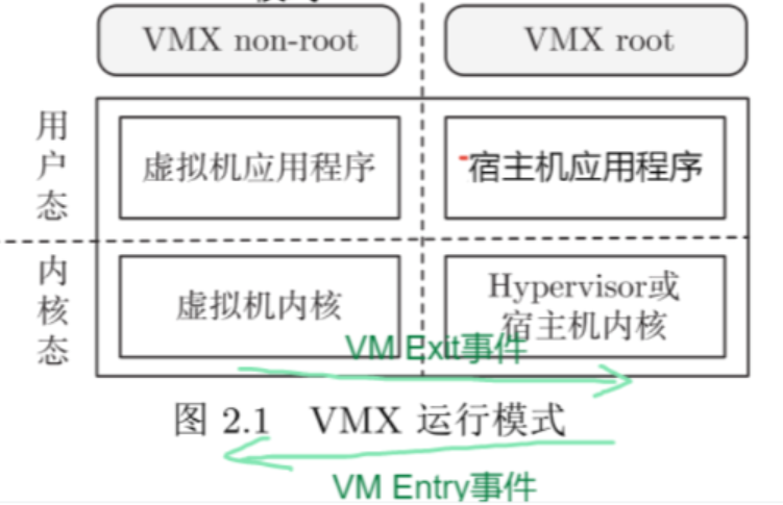

**嵌套场景**：L0 运行在 VMX root 模式，L1 和 L2 运行在 VMX non-root，但是 L1 以为自己运行在 VMX root 模式。L2 运行在客户端模式。

### 影子VMCS

问题：

由于实际能使用VMX指令的是 L0，所以任何层次的陷入都最终由 L0 处理、转发。这会造成昂贵的消耗。

> （1）世界切换是昂贵的
>
> （2）具体的延迟取决于造成世界切换的原因
>
> （3）从L2触发比从L1触发消耗大

解决：影子VMCS

L1 在 guest 态执行 VMREAD/VMWRITE 时，硬件不退出，而是把这些操作直接重定向到 vmcs01.shadow_vmcs 上

但是对少数字段仍然需要退出：

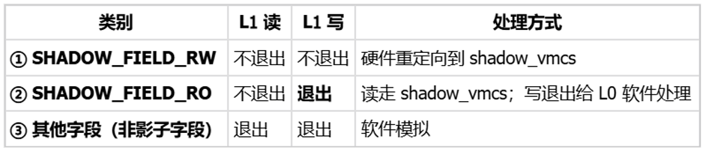

另外，除了 VMREAD/VMWRITE 外，其他所有 VMX 指令仍然会退出到 L0，由 L0 模拟。

仍然存在的问题：

- 嵌套虚拟化对内存密集型负载仍很昂贵
- 非内存密集负载开销可忽略，但内存密集负载（频繁页表更新、地址转换、并发内存访问）性能下降可达两个数量级。

### VMCS

虚拟机控制结构（virtual machinecontrol structures, VMCS）：负责维护 VCPU 相关的数据结构与状态信息

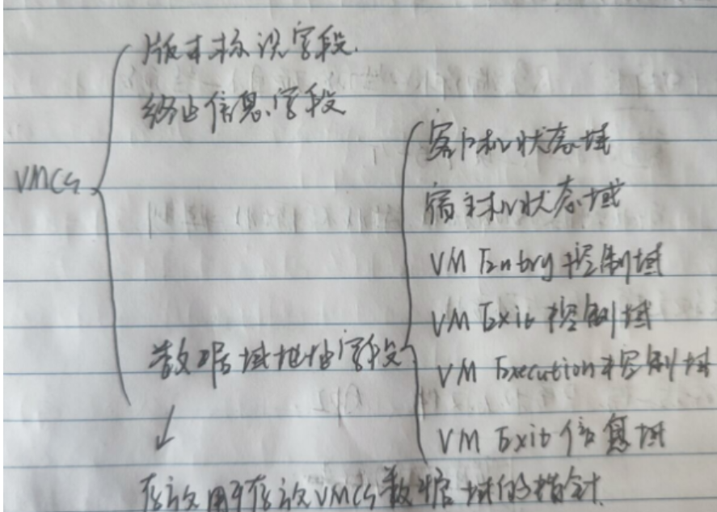

> 对于一个VM-Exit，处理器需要保存guest VM的CPU状态（上下文）到VMCS，同时从VMCS中加载hypervisor的CPU状态。对于VM-Entry过程相反。
>
> 这些操作会产生不可忽略的性能开销。

**VMCS01**：以 L0 的视角 L1 的环境，是 L0 用于运行 L1 的（跑L1时装进硬件）

**VMCS12**：以 L1 的视角 L2 的环境，通过 VMREAD/VMWRITE 访问（从不装进硬件）

**VMCS02**：以 L0 的视角 L2 的环境，是 L0 用于运行 L2 的（跑L2时装进硬件）

>  L0 结合 VMCS01 和 VMCS12 创造了 VMCS02

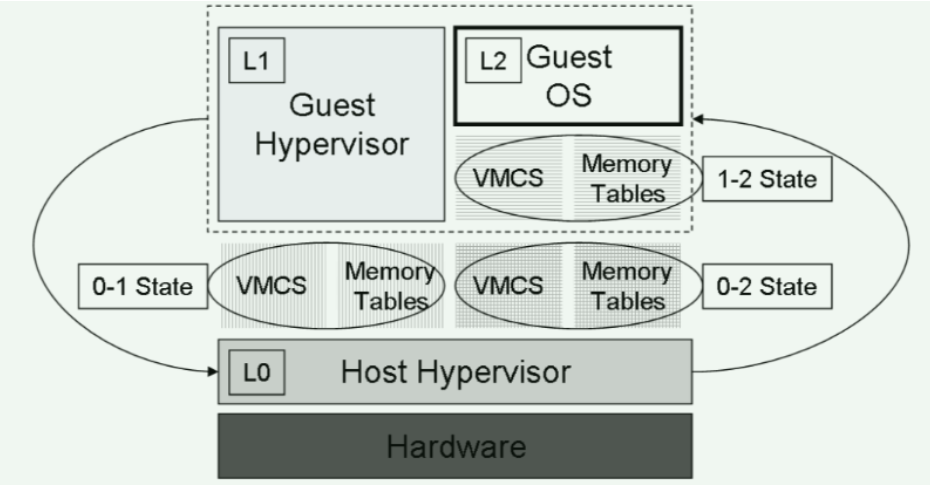

#### VMCS什么时候同步（嵌套虚拟化）？

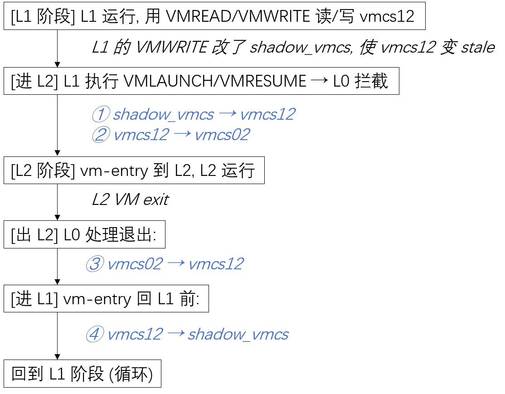

### L1执行VMX指令

#### L2启动

（1）L1 准备运行 L2 的规范（VMCS12）；

（2）L1 使用 VMX 指令（VMRESUME/VMLAUNCH）启动 L2；

（3）由于 VMX 指令只能在 root 模式下运行，所以会陷入 L0，由 L0 模拟执行；

（4）L0 需要先将 VMCS12 翻译为 L0 可以直接使用启动 L2 的规范（VMCS02），即 VMCS12 和 VMCS02 同步；

（5）L0 启动 L2。

执行路径：L1 -> L0 -> L2

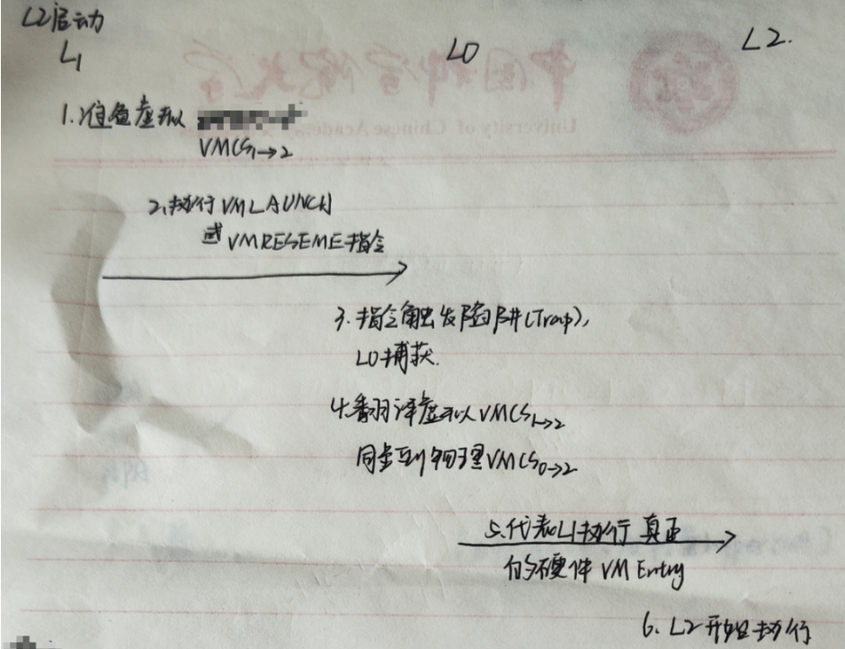

#### L1 执行其它 VMX 指令

> 不是 VMRESUME/VMLAUNCH 这种运行一个新的 VM 的指令

L1 执行的时候先陷入 L0，由 L0 模拟执行，执行之后由 L0 进入 L1。

执行路径：L1 -> L0 -> L1

### 事件处理

**L2 退出**：

（1）L2 发生事件；

（2）触发硬件 VM Exit；

（3）L0 捕获退出事件，判断由自己处理还是转发给 L1。

**第一种情况**：该 VM Exit 事件与 L0 相关（VMCS02 中指定的陷入事件），L0 自己处理；

执行路径：L2 -> L0 -> L2

**第二种情况**：该 VM Exit 事件与 L1 相关（VMCS12 中指定的陷入事件），L0 将其转发给 L1（通过将处理器更新的 VMCS02 字段复制到 VMCS12 并恢复 L1），由 L1 自行处理。L1 处理完成之后使用 VMRESUME/VMLAUNCH 恢复 L2 的运行。

执行路径：L2 -> L0 -> L1-> L0 -> L2

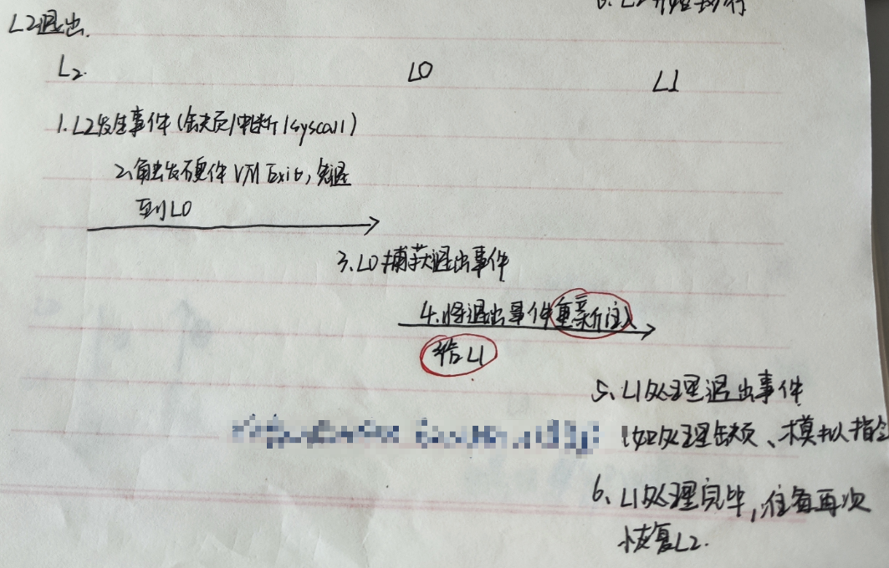

### 性能瓶颈总结

缺点：

1. L1 执行大部分VMX指令的时候会陷入 L0 ，由 L0 模拟执行 -》大量的世界切换
2. VMCS12 和 VMCS02 同步

优点：

1. 消除了大部分因为执行 VMREAD/VMWRITE 时，产生的 VM Exit 《- 借助 shadow_vmcs

## 内存虚拟化

> [!NOTE]
>
> 专业词：
>
> •**HPT**：宿主机页表，维护宿主机虚拟地址（HVA）到宿主机物理地址（HPA）的映射
>
> •**GPT_L1**：客户端L1页表，维护客户端L1虚拟地址（GVA_L1）到客户端L1物理地址（GPA_L1）的映射
>
> •**GPT_L2**：客户端L2页表，维护客户端L2虚拟地址（GVA_L2）到客户端L2物理地址（GPA_L2）的映射
>
> •**EPT0->1**：由 L0 宿主机 Hypervisor 维护，负责将 L1 客户机 Hypervisor 的“物理地址”（GPA_L1），转换为真实的宿主机物理地址（HPA）。
>
> •**EPT1->2**：由 L1 客户机 Hypervisor 为自己管理的虚拟机（L2）维护的 EPT 表，负责将 L2 的客户机物理地址（GPA_L2） 转换为 L1 的客户机物理地址（GPA_L1）。
>
> •**EPT0->2**：L0 会把 EPT1→2和 EPT0→1 这两张表的映射关系“压缩”或“合并”成一张新的影子表 EPT0→2。它的映射关系直接是：GPA_L2 → HPA。

主要解决的问题：在支持2级分页的硬件上，进行三级页表翻译

### 地址翻译

#### SPT-on-EPT

典型代表：PVM

在 L1 或客户机 Hypervisor 中维护一个 SPT（影子页表），以处理最高两级的地址转换。

##### 地址翻译过程：

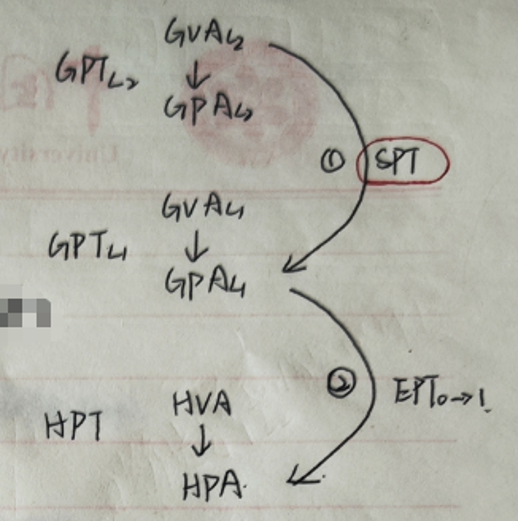

GPT_L2 + GPT_L1 = SPT

##### 建立映射过程：

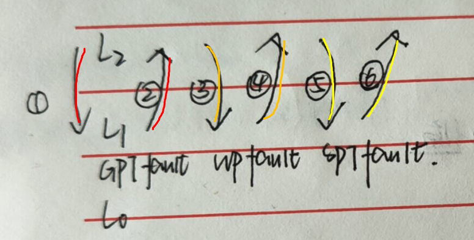

#### EPT-on-EPT（KVM中的默认方法）

> 该方法效果优于SPT-on-EPT，具体可看论文笔记部分

每个层次创建自己的 EPT。L0 暴露虚拟 EPT 能力给 L1，L1 创建 EPT12。L0 把 EPT01 和 EPT12 压缩成 EPT02，使 L2 客户机物理地址直接翻译到 L0 主机物理地址。

##### 地址翻译过程：

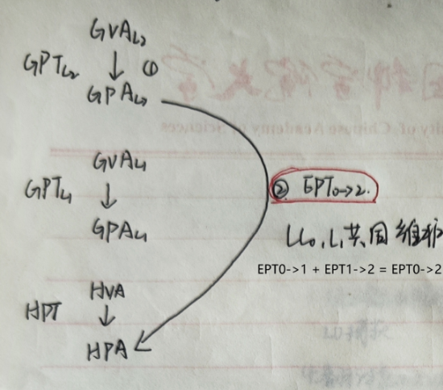

更详细的地址翻译过程：

**CR3**是给MMU做第一级翻译用的，

**EPT指针**(EPTP)是给MMU做第二级翻译用的，

最终由同一个CPU MMU内部完成page walker连续完成2级翻译

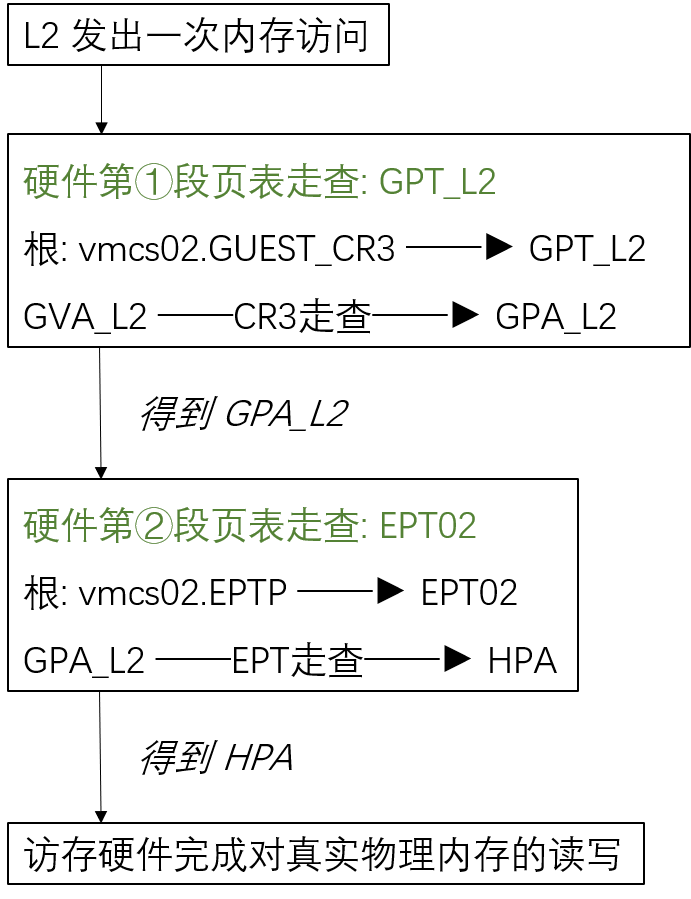

##### 建立映射过程（最长路径）：

L0 以空 EPT02 启动 L2，在 EPT violation 时动态构建；若 EPT12 中无映射，先让 L1 处理并更新 EPT12，再建立 EPT02。L0 把 EPT12 内存设为只读以捕获 L1 修改，并捕获 INVEPT 指令。还使用大页、VPID 等优化。

> 为什么这里的 EPT12 要设置为只读？因为 L0 需要用其维护 EPT02 的正确性。
>
> VPID机制：
>
> 每次发生VM退出或VM进入事件，CPU会强制执行TLB刷新操作，导致TLB中所有条目同时失效，导致不必要的内存开销。
>
> 解决方案：VPID方案，将VMCS与对应的TLB绑定

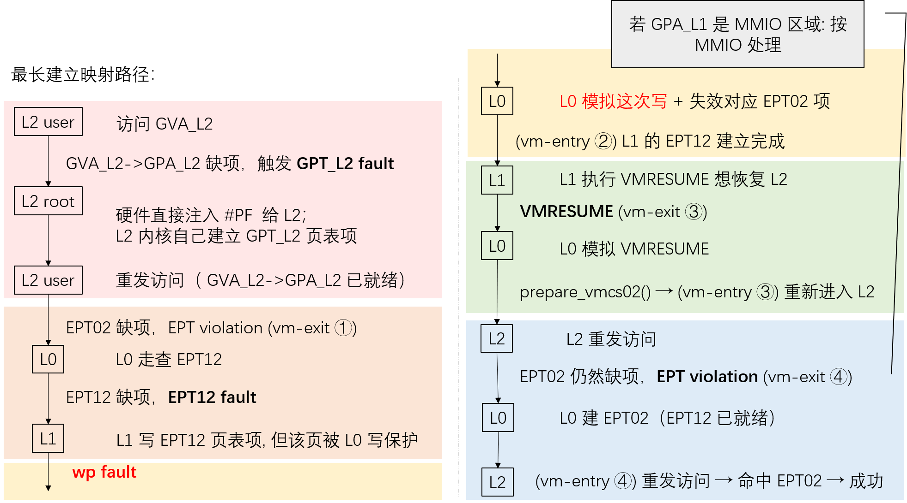

软件走查页表：

- **GPT_L2**：由 L2 的 guest 内核建立（软件，L2 处理自己 #PF 时填表项）
- **EPT12**：由 L1（guest hypervisor）建立（软件，L1 处理被反射来的 nested EPT fault 时填表项）
- **EPT02**：由 KVM（L0）建立（软件，L0 处理 EPT violation 时走查 EPT12+EPT0 后填表项）

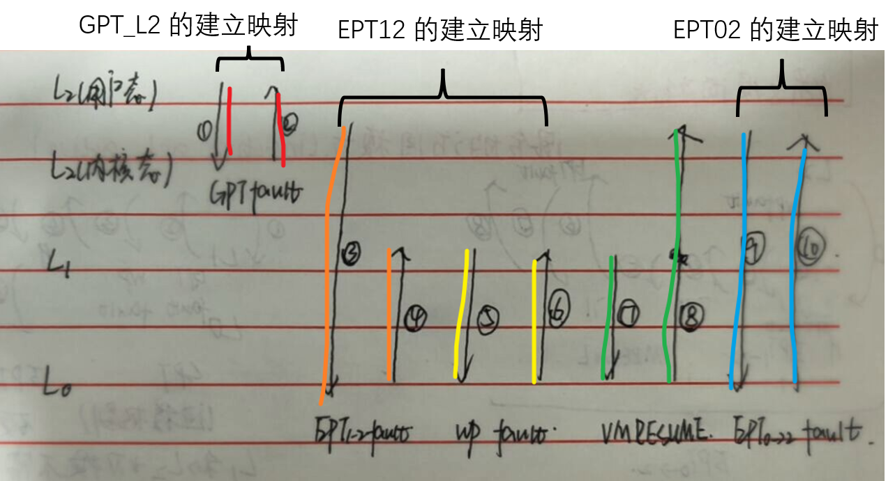

### 性能瓶颈总结

缺点：

1. 多次世界切换（VMExit/Entry）—— 最大开销
2. 软件走查页表（CPU 开销）
   1. L0 走查 EPT12（判断是否缺项 + 建 EPT02）；
   2. L1 走查 EPT12（建 EPT12）；
   3. L2 走查 GPT_L2（建 GPT_L2）。
3. 写保护拦截 + 模拟写
4. 页表页分配
   1. L1 建 EPT12、L0 建 EPT02 时，都要分配页表内存页。

> EPT12 和 EPT02 之间的同步

5. 随着L2增加，页表同步更复杂，开销更大

优点：

1. 二级地址翻译

## I/O虚拟化

嵌套2层就有9种方案，其中在 L0 & L1 之间的 I/O 虚拟化方法，以及 L1 & L2 之间的 I/O 虚拟化方法均为设备直接分配，这种方案被称为**多级设备分配（multi-level device assignment）**。

多级设备分配方案需要处理三个挑战：

（1）

DeviceDMA（设备直接内存访问） 是指：外设（如网卡、磁盘控制器）**不经过 CPU 逐字节搬运**，而是由设备自己的 DMA 引擎**直接读写主内存**。

简单流程：

1. CPU 告诉设备：数据在内存哪里、要传多少、传到哪个设备缓冲区。
2. 设备直接与内存之间传输数据。
3. 传完后设备发中断通知 CPU。

⬇

**在虚拟化中的难点**：

- 客户机驱动用的是**客户机物理地址**；
- 真实设备 DMA 用的是**主机物理地址**；

⬇

解决方案：IOMMU：使用翻译表将客户机物理地址翻译成主机物理地址

⬇

IOMMU只支持一级地址翻译，但嵌套虚拟化需要两层（L2→L1、L1→L0）

⬇

将2层地址翻译压缩成一层：

方案一（更快、更简单）：① L1 中的 IOMMU 映射：L2->L1 ② L1 通过 hypercall 请求 L0 帮忙 ③ L0 将 L1 的地址翻译成 L0 的地址 ④ L0 将 映射 L2->L0 写入真实硬件 IOMMU

方案二：L0 模拟 IOMMU 硬件，让 L1 以为自己运行在真实的 IOMMU 上

（2）当前 x86 中**中断**先导致 VMExit 到 L0，L0 转发 L1，L1 再注入 L2；中断结束（EOI） 也会导致退出，开销较大。

解决方案：硬件直接向 L2 投递中断

（3）内存映射I/O(MMIO)和端口I/O(PIO)：嵌套客户机与单层客户机类似，关键 I/O 路径不一定产生退出。

### 设备发现

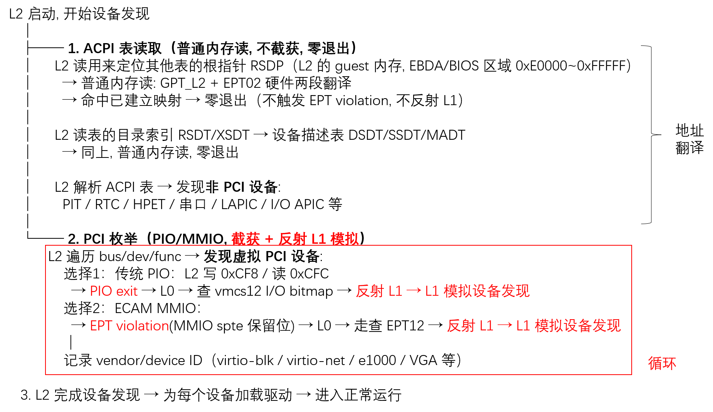

### 设备截获

#### PIO路径

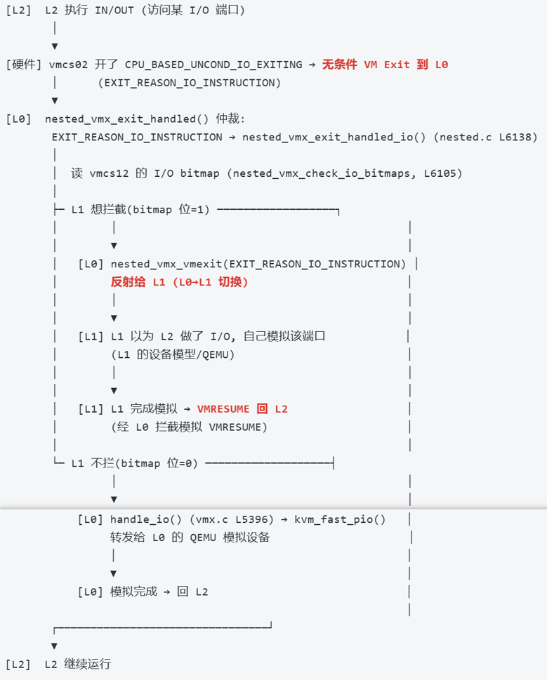

#### MMIO 路径

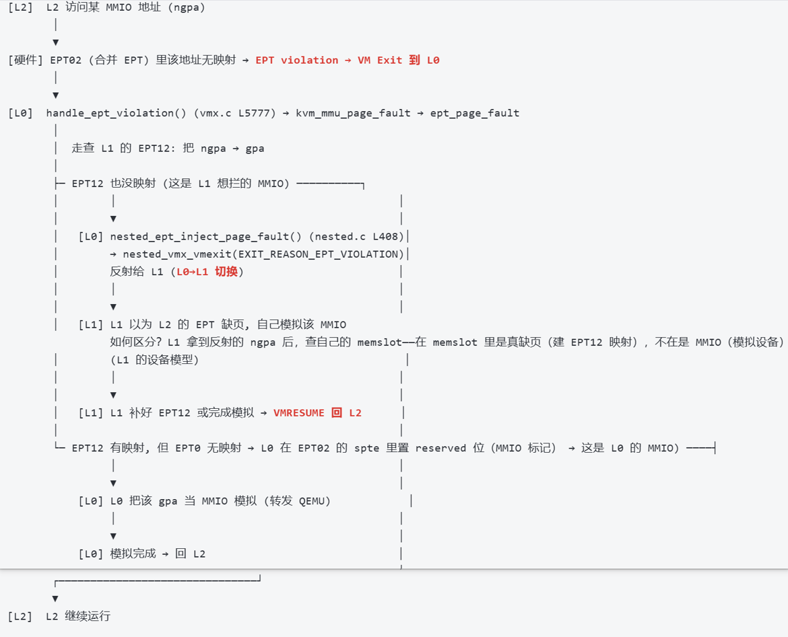

### 设备模拟

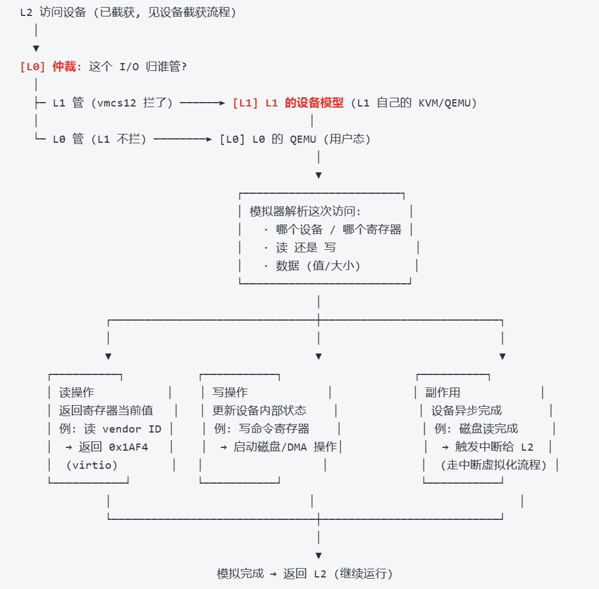

设备半虚拟化：一个虚拟设备被L0管理，暴露给L1；另一个虚拟设备被L1管理，暴露给L2

> 半虚拟化方法需要完成宿主机中物理设备翻译I/O事件到虚拟设备

**For networks**

- Nested-VirtIO：
  - 从 L2 到物理服务器外部世界的网络 I/O 必须通过管理物理网卡的 L0 来完成。在一种称为 Nested-VirtIO 的简单方法中，由 L1 在 L2 和 L0 之间进行中介（转发）。
  - L0 向 L1 暴露一个虚拟网卡（vNIC01），而 L1 则创建自己的 vNIC（vNIC12），并将其暴露给 L2。在底层实现上，L1 连接 vNIC01 和 vNIC12，并在两者之间转发流量。
  - L2 → vNIC12（L1 暴露给 L2 的 VirtIO 网卡）→ L1 内部连接/转发 → vNIC01（L0 暴露给 L1 的 VirtIO 网卡）→ L0 → 物理 NIC
  - 执行路径：
    - L2 ──WS1: vm-exit──> L0
    - L0 ──WS2: 注入/进入──> L1
    - L1 ──WS3: vm-exit──> L0
    - L0 ──发送──> 物理 NIC
    - WS1：L2 → L0：L2 对 vNIC12 的 MMIO write 触发 vm-exit，CPU 先退出到 L0。
    - WS2：L0 → L1：L0 把该事件注入 L1，进入 L1 hypervisor；L1 将请求转给 vNIC12 的 virtio worker。
    - WS3：L1 → L0：vNIC12 worker 要发送包时，对 vNIC01 执行类似的 MMIO write，触发 L1→L0 的 vm-exit。
    - L0 完成发送：L0 把请求转给 vNIC01 的 virtio worker，由其通过物理 NIC 发出。
- Direct-Assignment（直接分配）：
  - 利用 QEMU 的 IOMMU 模拟：L0 向 L1 暴露多个 vNIC，使 L1 能够将 vNIC01 直接连接到 L2，从而有效将 L1 从 L2 网络数据路径中移除。
  - L2 的网络数据路径： L2 ↔ vNIC01 ↔ L0 ↔ 物理 NIC
  - 执行路径：
  -  L2 ──WS1: vm-exit──> L0 ──> 物理 NIC
  - WS1：L2 → L0：L2 对 `vNIC02` 执行 MMIO write 通知待发送包，触发 vm-exit 到 L0。
  - L0 完成发送：L0 的 virtio worker 直接通过物理 NIC 发送该包。
- Direct-Assignment（直接分配）缺点：
  - 禁用了 L1 对 L2 网络的控制——L1 无法影响其 L2 客户机的网络管理操作策略，例如路由、监控和流量整形，而这些对于容器的正常运行至关重要。

### 性能瓶颈总结

设备发现：

- 优点：ACPI 表读取就是普通的内存访问
- 缺点：PCI 枚举（PIO/MMIO）涉及到 L0 截获 + 反射 L1 模拟，并且这是一个循环的过程 à 世界切换频繁

设备截获/设备模拟：

- 缺点：必须陷入到 L0 ，由 L0 仲裁是自己模拟还是 L1 模拟 à 世界切换频繁

## 中断虚拟化

### 中断处理流程（单VCPU场景）

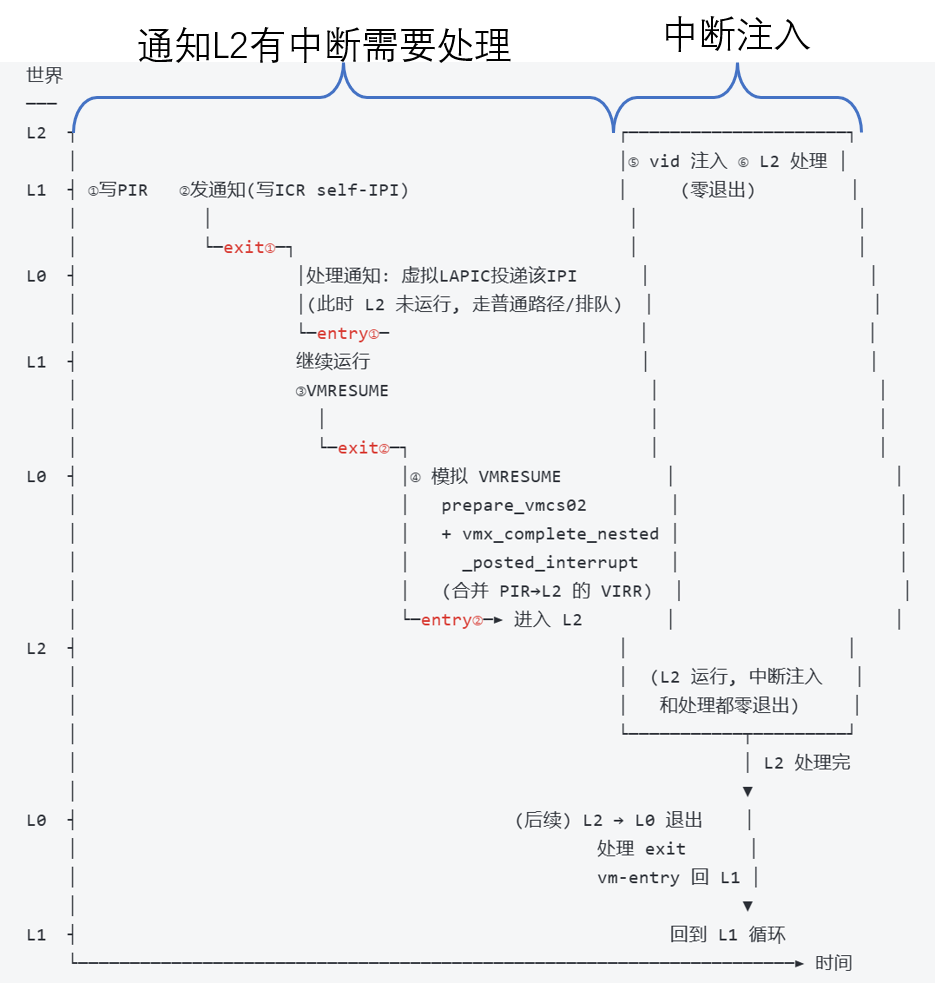

每次世界切换及原因: 

- **exit① (L1→L0)**: L1 写 ICR 发 self-IPI 通知, APIC-access 被拦截 
- **entry① (L0→L1)**: L0 处理完通知投递, 返回 L1 
- **exit② (L1→L0)**: L1 执行 VMRESUME 想进 L2, 被拦截 
- **entry② (L0→L2)**: L0 模拟 VMRESUME + 合并 PIR→L2 VIRR, 进入 L2
-  **(后续) L2→L0**: L2 处理完中断, 返回 L1 时退出

### 中断处理流程（多VCPU场景）

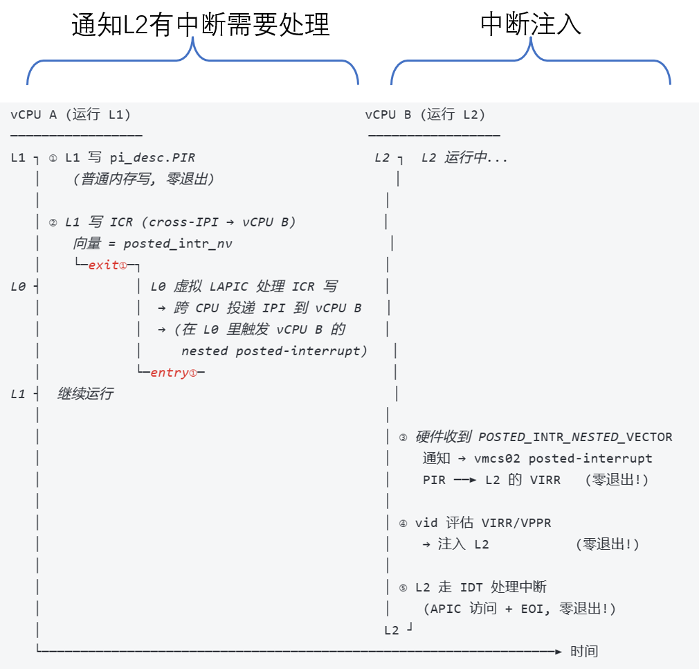

每次世界切换及原因: 

- **exit①** (vCPU A: L1→L0): L1 写 ICR 发 cross-IPI 通知, APIC-access 被拦截 
- **entry①** (vCPU A: L0→L1): L0 处理完 ICR 写 + 跨 CPU 投递通知, 返回 L1 
- **vCPU B 全程零世界切换!** (通知到达 → PIR→VIRR → vid 注入 → L2 处理, 全由硬件完成)

### 性能瓶颈总结

缺点：

1. vCPU A 写 ICR 的 VM Exit：L1 发通知（写 ICR cross-IPI）触发一次 APIC-access exit → L0 处理 → entry 回 L1 的完整往返，这是唯一的 VM Exit。

优点：

1. vCPU B（L2 侧）零退出
2. 并行性：vCPU A 发完通知后继续跑（不用等 L2），vCPU B 也继续跑，互不阻塞。
3. 无需软件兜底：多 vCPU 下是硬件路径（vmcs02 的 posted-interrupt 直接合并），不像单 vCPU 要走 vmx_check_nested_events + vmx_complete_nested_posted_interrupt 软件合并。